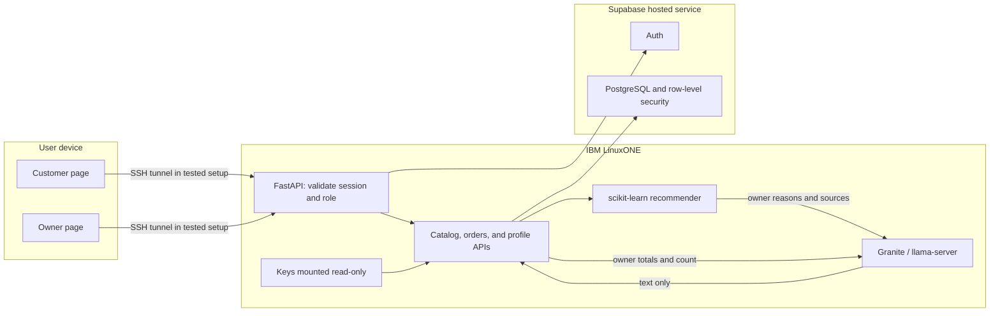
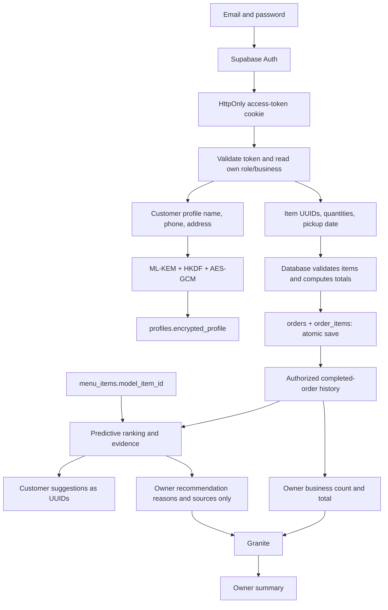

# Current architecture

Two roles, one FastAPI application, one Supabase project, and two AI runtimes. Admin pages, drag-and-drop widgets, payment processing, and autonomous model tools are outside the current scope.

## System flow

Granite is a separate container reached at `http://granite:8080/v1`. App and Granite published ports bind to loopback. Supabase remains an external hosted dependency. There is no demonstrated Telum acceleration or quantum-safe transport.

## Data flow

## Database responsibilities

| Table | Necessary information |
|---|---|
| Supabase `auth.users` | Authentication account managed by Supabase |
| `profiles` | Auth user UUID, role, owner business UUID, encrypted profile, timestamp |
| `businesses` | Business UUID, name, active flag, timestamp |
| `menu_items` | UUID, business UUID, name, description, price, availability, nullable model ID |
| `orders` | UUID, customer UUID, business UUID, status, total, pickup date, timestamp |
| `order_items` | Order UUID, menu UUID, quantity, captured unit price |

Customer UUIDs come from the session. Owner business UUIDs come from the protected profile. Client-provided business/menu UUIDs in customer requests must identify an active business and its available items. RLS is an additional data boundary.

## AI responsibilities

- Customer input: selected item, cart items, available mapped menu, and only that customer's completed-order baskets for the requested business.
- Owner input preparation: completed orders and available menu for the session's business. No profile query is part of summary preparation.
- Model IDs are explicit, not inferred from sorting or UUID suffixes. Only six matching Store 1 items currently have mappings.
- The predictive Python helper receives item features and baskets; it does not query Supabase. Internal item IDs are necessary predictive features.
- Granite receives completed count/value and explanation/source strings. UUID fields are stripped before prompt construction. Menu names remain in explanations.
- Model text cannot create orders, execute commands, query the database, or change permissions through an exposed tool interface.

## Scope of profile encryption

Only name, phone, and address in `encrypted_profile` are covered by application-level PQC-assisted encryption. Database identifiers, order data, and authentication email are not encrypted by this helper. Persistent private keys stay on LinuxONE; the database stores the encapsulation, salt, nonce, ciphertext, algorithm, and key version. AAD binds ciphertext to the user UUID and format version.

See [API contract](API_CONTRACT.md), [deployment](DEPLOYMENT.md), and [known limitations](KNOWN_LIMITATIONS.md).
