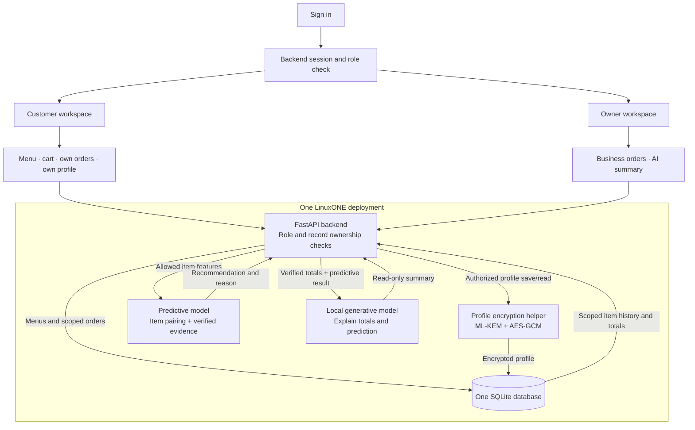

# SimpleCater: two roles, one secure AI workflow

Login/session verification and role-guarded pages/API boundaries are represented by the backend scaffold. Login issuance, records, encryption and models must still be completed. Browser demo simulates the two accounts; it is not actual authorization. Models get neither profiles nor database credentials. The frontend displays text only; neither model publishes content or runs commands.

Database tables: users (encrypted profile and role), businesses, menu_items, orders, order_items, sessions. No separate analytics database. One backend function prepares permitted data.

Customer flow: sign in -> select item -> model pairing + evidence -> cart -> server-priced order -> own history.
Owner flow: sign in -> own business orders -> aggregate statistics + actual predictive output -> local LLM -> summary.
Profile flow: customer authorization -> encryption/decryption helper -> stored ciphertext. Profiles never enter AI flow.

Container image currently covers core server only. Finish native dependencies/model mounts and verify runtime on LinuxONE before claiming containerized AI execution.
