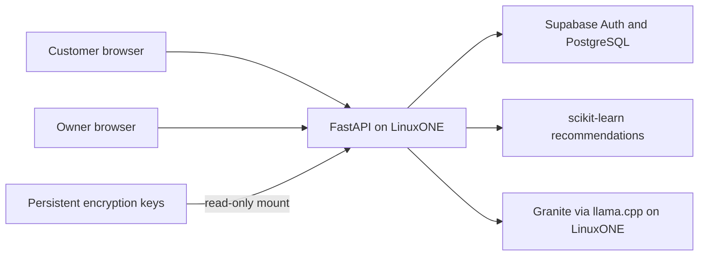

# SimpleCater on IBM LinuxONE

A catering-ordering prototype for the **Secure AI — Innovation Without Exposure** theme. Customers order food and maintain encrypted contact profiles. Business owners review their own orders and request AI summaries based on verified business totals and recommendation evidence.

## Working capabilities

- Supabase email/password login, session validation, logout, and separate customer/owner pages.
- Supabase catalog, cart, atomic checkout with database-controlled prices, and scoped order history.
- Customer profile encryption before storage: ML-KEM-768 → HKDF-SHA256 → AES-256-GCM.
- Customer suggestions based on the selected menu item and the customer's completed orders at that business.
- Owner summaries combining a scikit-learn recommender with Granite running on LinuxONE.
- Explicit UUID-to-model-ID mappings; model, popularity fallback, and random suggestions are distinguished.
- Docker deployment with read-only key mounting and private app-to-Granite communication.

The owner dashboard's order value is not collected revenue. Payment processing is deferred. This is a hackathon prototype, not a production security certification.

## Team

Existing repository credits: Shivansh Batra, Arman Sarder, Eshwar Singh Rajaputana, MUHD Ayman Haque, and Aryan Tomar. The five workstreams in the team plan describe responsibilities, not a verified five-person roster; confirm final names and contributions before submission.

## Start here

| Document | Purpose |
|---|---|
| [Deployment](docs/DEPLOYMENT.md) | LinuxONE Docker setup, SSH access, troubleshooting |
| [Architecture](docs/ARCHITECTURE.md) | System and data-flow diagrams |
| [Tech stack](docs/TECH_STACK.md) | Actual tools, versions, and responsibilities |
| [API contract](docs/API_CONTRACT.md) | Current request and response shapes |
| [Profile encryption](docs/PROFILE_ENCRYPTION.md) | Native library, persistent keys, boundaries |
| [Security evidence](docs/SECURITY_EVIDENCE.md) | What was tested and what was not |
| [Open-source resources](docs/OPEN_SOURCE_RESOURCES.md) | Software, model, and asset credits |
| [Team plan](docs/TEAM_PLAN.md) | Five workstreams and final handoffs |
| [Remaining work](docs/KNOWN_LIMITATIONS.md) | Deployment, reproducibility, and product limits |

## Architecture at a glance



## Run the assembled application

Use LinuxONE s390x, an existing configured Supabase project, and the deployment's existing encryption keys. The database migrations are incremental, not a fresh-project bootstrap. Follow [deployment prerequisites](docs/DEPLOYMENT.md) before running:

```bash
docker compose up -d --build
curl --max-time 10 http://127.0.0.1:8000/health
```

Mac browser access uses an SSH tunnel to port 8000. A static frontend preview is simulated and does not run real authentication or AI; see [frontend instructions](frontend/README.md).

## Evidence and limits

The team reported successful LinuxONE/browser tests for checkout, encrypted profile persistence, both AI interfaces, and account isolation. An intercepted Granite request was checked for unnecessary identifiers and credentials. Details and qualifications are in [security evidence](docs/SECURITY_EVIDENCE.md).

The committed model evaluation uses synthetic data. It is not a measurement of real catering sales or customer impact. Live examples used popularity fallback; controlled test history also exercised the model-ranked pairing path. New orders begin as pending, while AI history uses completed orders. There is no application order-status editor.

Supabase Auth and PostgreSQL are hosted outside LinuxONE. Application inference and profile encryption run on LinuxONE; do not claim all data remains on premises or all traffic is quantum-safe.
